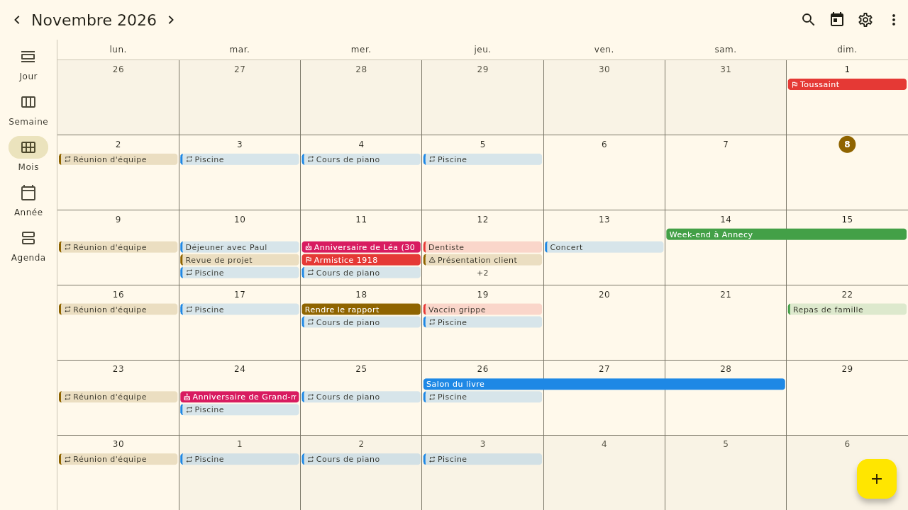
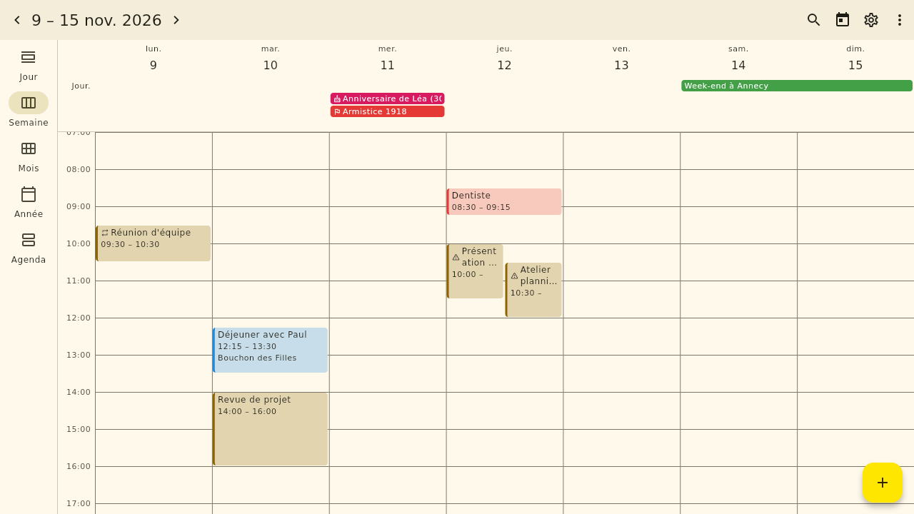
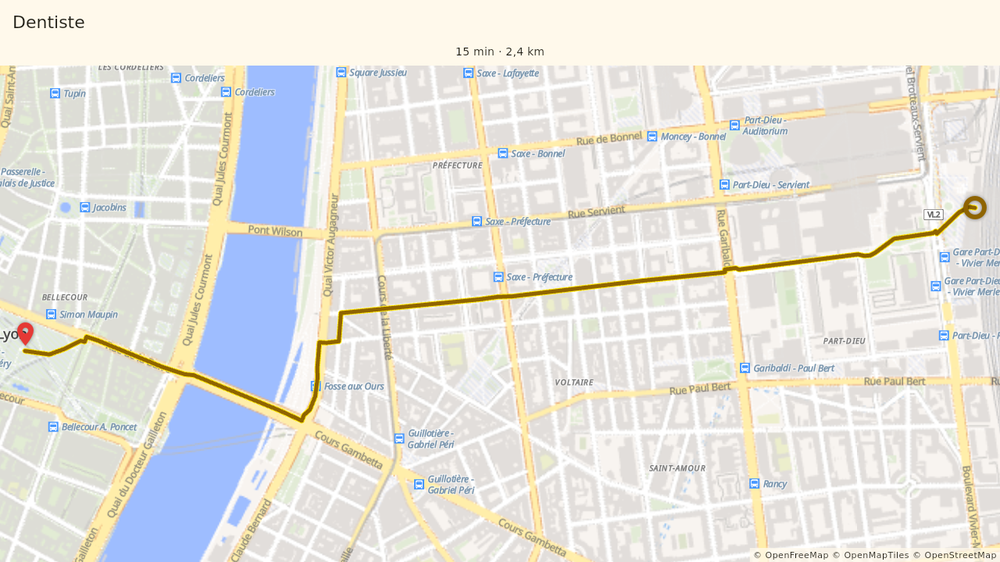

# Poulplan

Calendrier personnel **local d'abord** de l'écosystème **Poulapp**, pour
Android et Linux (KDE Plasma). Logiciel libre (GPL-3.0), utilisable sans
compte ni connexion ; la synchronisation entre appareils est facultative.



| Semaine | Trajet mémorisé |
|---|---|
|  |  |

## Fonctions

- **Calendrier** : vues jour, semaine, mois, année et agenda ; événements sur
  la journée ou plusieurs jours, fuseaux horaires, glisser-déposer,
  chevauchements signalés.
- **Répétitions** : quotidiennes à annuelles, règles personnalisées (chaque
  lundi et jeudi, dernier vendredi du mois…), dates de début et de fin,
  modification d'une occurrence, de la série ou des suivantes, règle pour les
  jours fériés.
- **Rappels** multiples et reportables, même application fermée (alarmes
  exactes sur Android, icône de la zone de notification sous Linux).
- Jours fériés français (dont Alsace-Moselle), **vacances scolaires**,
  anniversaires (saisie, import VCF ou contacts Android), recherche avec
  filtres enregistrables, catégories et couleurs.
- **Pièces jointes**, **lieux sur la carte** (OpenStreetMap), temps de trajet
  en voiture, vélo ou à pied, cartes hors ligne ; recalcul hors ligne sur
  Android avec l'application libre [BRouter](https://f-droid.org/packages/btools.routingapp/).
- **Widgets** Android (Journée, À venir, Mois, thème clair et sombre) et KDE
  Plasma (Journée, À venir).
- **Sauvegardes** automatiques locales et cloud, restauration, export ICS ;
  **verrouillage** par code ou biométrie ; espace de stockage et nettoyage.
- **Synchronisation facultative** (cloud Poulapp, Supabase) : modifications
  enregistrées localement d'abord, fusion champ par champ, conflits soumis à
  l'utilisateur seulement quand ils sont réels.

## Installation

- **Android** : bientôt sur F-Droid (fiche dans `fastlane/`, recette dans
  [`docs/PUBLICATION.md`](docs/PUBLICATION.md)).
- **Linux** : Flatpak (`linux/packaging/org.poulapp.poulplan.yml`), ou pour le
  développement `tool/install_linux_dev.sh` après `flutter build linux --release`.

## Développement

```bash
flutter pub get
dart run build_runner build --delete-conflicting-outputs   # code généré Drift (commité)
flutter analyze
flutter test
flutter run -d linux                                   # sans cloud
flutter run -d linux --dart-define-from-file=.env      # avec le cloud Poulapp (.env local, voir .env.example)
```

- Calendrier de démonstration (captures, essais) sans toucher au vrai :
  `dart run tool/demo_data.dart /tmp/poulplan-demo` puis
  `POULPLAN_DATA_DIR=/tmp/poulplan-demo flutter run -d linux`.
- Cloud : scripts SQL et mise en place dans [`supabase/`](supabase/README.md).
- Documents : [cahier des charges](docs/SPEC.md),
  [feuille de route](docs/ROADMAP.md), [avancement](docs/PROGRESS.md),
  [décisions](docs/DECISIONS.md), [tests manuels](docs/TESTS_MANUELS.md),
  [licences des dépendances](docs/LICENSES.md).

## Données et services

Tout est stocké sur l'appareil (SQLite). Services réseau utilisés seulement
à la demande : recherche d'adresse [Nominatim](https://nominatim.org/),
trajets [OSRM de FOSSGIS](https://routing.openstreetmap.de/), fond de carte
[OpenFreeMap](https://openfreemap.org/) — données © contributeurs
OpenStreetMap. Aucune publicité, aucun pistage.

## Licence

GPL-3.0-or-later — voir [`LICENSE`](LICENSE).
